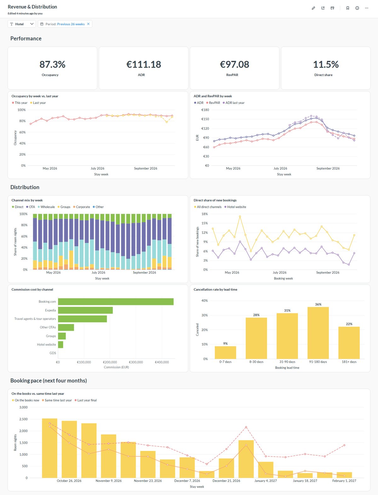
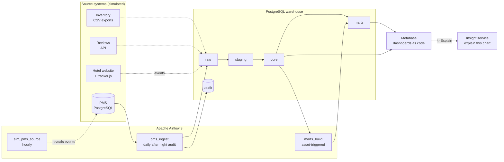

# HotelPulse

**An end-to-end data platform for hotel operations.** Bookings from the property management
system (PMS), website tracking events, consumables inventory and guest reviews flow through an
Airflow-orchestrated PostgreSQL warehouse into Metabase dashboards — and every chart gets a
button that explains what it shows in plain language.


---

## The business problem

A mid-sized hotel group (two properties: a city hotel in Lisbon and a resort in the Algarve)
reviews its operations every Monday. Three decisions keep coming back:

| Decision | Question the data must answer |
|---|---|
| **Revenue & distribution** | Only ~12 % of room nights are booked direct, OTAs charge 15–20 % commission. Where do direct bookers drop off, and what does it cost? |
| **Procurement & operations** | How many amenities will we need in the next two weeks? Which consumption figures are abnormal? |
| **Guest experience** | Why do ratings move? Do complaints correlate with operational pressure such as full-house days? |

The data sits in separate systems and the general managers have no time to read dozens of
charts. HotelPulse integrates the sources, models them into decision-oriented dashboards and
lets every chart **explain itself** in plain language.

## Features

| Area | What it does | Status |
|---|---|---|
| Living source systems | A simulated PMS replays 119k real bookings, shifted by whole years (seasons and weekdays stay aligned) so that history, today and future reservations line up with the wall clock. Known anomalies are injected as ground truth. | ✅ |
| Layered warehouse | `raw → staging → core → marts` in plain PostgreSQL SQL: append-only raw change log, `MERGE`-based staging, star schema, dashboard-ready marts | ✅ |
| Orchestration | Airflow 3 DAGs with incremental, idempotent loads (data-interval windows with look-back), asset-driven downstream scheduling, backfill support | ✅ |
| Data quality as code | SQL checks that return violating rows; results persisted to `audit.dq_results`; error-level failures stop the pipeline | ✅ |
| Revenue analytics | Occupancy, ADR, RevPAR, channel mix and commission cost, booking pace (on-the-books vs. same time last year) | ✅ |
| Dashboards as code | Metabase questions and dashboards defined in YAML + SQL and provisioned through the Metabase API | ✅ |
| Privacy by design | Personal data stops at staging (salted hashes); BI uses a read-only role limited to modelled schemas | ✅ |
| Website tracking | Demo booking site, JavaScript tracker, event collector, sessionisation, booking funnel, attribution and reconciliation against the PMS | 🚧 |
| Operations & reviews | Consumables forecasting and purchase suggestions; review ingestion with topic and sentiment tagging | 🚧 |
| **Explain this chart** | A button next to every chart: computes facts (deltas, anomalies, drivers), turns them into a narrative with an LLM and verifies every number against the facts | 🚧 |

## Dashboard



*Revenue & Distribution: KPIs, year-over-year trends, channel mix, direct booking intake and the booking pace for the next four months. The dip in direct bookings at the end of September is an injected anomaly (a mobile payment outage pushing guests to OTAs).*

## Architecture



All services run with Docker Compose: PostgreSQL 17 (warehouse, source system and application
databases with least-privilege roles), Airflow 3.3 (LocalExecutor) and Metabase 0.64.

## Data pipeline workflow

1. **Source simulation** — `sim_pms_source` runs hourly and reveals every booking, check-in,
   check-out, cancellation and no-show that has "happened" up to now.
2. **Extract** — `pms_ingest` runs daily after the hotels' night audit (03:00 Europe/Lisbon). It
   pulls rows changed in the data interval (plus a look-back window for late commits) with a
   read-only account and appends them to `raw` with batch metadata. An empty warehouse triggers
   an automatic full load.
3. **Stage** — the newest version of each entity is `MERGE`d into `staging`: types and codes are
   cleaned, data issues are flagged, personal data is replaced by salted hashes.
4. **Model** — `core` dimensions are refreshed; facts are maintained incrementally for exactly
   the reservations that changed in the batch (`fct_reservation`, `fct_room_night`).
5. **Serve** — finishing `pms_ingest` updates the `core.fct_room_night` asset, which triggers
   `marts_build` to rebuild the marts in a single transaction.
6. **Verify** — data-quality checks run after every layer; results are stored in `audit` and
   shown on a data-health dashboard.

| DAG | Schedule | Purpose |
|---|---|---|
| `sim_pms_source` | hourly | Advance the simulated PMS to the current time |
| `pms_ingest` | daily, 03:00 Europe/Lisbon | Extract → raw → staging → core, with quality checks |
| `marts_build` | on asset `core.fct_room_night` | Rebuild KPI, channel and booking-pace marts |

## Data model

| Layer | Content | Load strategy |
|---|---|---|
| `raw` | Source rows as extracted, plus `_batch_id` and `_extracted_at` | append-only (change log) |
| `staging` | One current row per entity, cleaned and typed, `dq_issues` flags, no PII | `MERGE` on natural key |
| `core` | `dim_date`, `dim_hotel`, `dim_room_type`, `dim_channel`, `fct_reservation`, `fct_room_night` | dimensions upserted; facts incremental per changed reservation |
| `marts` | `hotel_daily_kpi`, `channel_daily`, `channel_bookings_daily`, `booking_pace` | full rebuild in one transaction |
| `audit` | schema migrations, load log, data-quality results | append-only |

KPI definitions follow hotel industry conventions: **Occupancy** = rooms sold / rooms
available, **ADR** = room revenue / rooms sold, **RevPAR** = room revenue / rooms available,
**STLY** = on-the-books "same time last year" (364 days back, weekday-aligned).

## Getting started

**Prerequisites:** Docker with Compose v2 (about 5 GB of memory available to Docker), GNU Make,
and [uv](https://docs.astral.sh/uv/) for local development.

```bash
make env   # create .env with freshly generated secrets
make up    # build and start everything; first start seeds data and provisions dashboards
```

| Service | URL | Credentials |
|---|---|---|
| Metabase | http://localhost:3001 | `MB_ADMIN_EMAIL` / `MB_ADMIN_PASSWORD` from `.env` |
| Airflow | http://localhost:8081 | none (local demo mode) |
| PostgreSQL | `localhost:5433` | roles and passwords in `.env` |

Useful commands:

```bash
make help        # list all targets
make ps          # service status
make psql        # psql session on the warehouse
make down        # stop (data is kept)
make clean       # stop and delete all data volumes
```

## Project structure

```
.
├── dags/                    # Airflow DAGs (orchestration only)
├── src/hotelpulse/          # Python package
│   ├── simulator/           #   source-system simulators and injected anomalies
│   ├── pipelines/           #   extraction helpers used by DAGs
│   ├── metabase/            #   dashboards-as-code provisioning
│   ├── migrate.py           #   checksum-verified warehouse migrations
│   └── quality.py           #   data-quality runner
├── warehouse/
│   ├── migrations/          # V###__*.sql schema migrations
│   ├── sql/                 # transformations per layer (staging, core, marts)
│   └── tests/               # data-quality checks per layer
├── bi/metabase/             # dashboard and question definitions (YAML + SQL)
├── infra/                   # Dockerfile and database initialisation
├── tests/                   # unit tests and DAG integrity tests
└── docker-compose.yml
```

## Development workflow

- **Branching:** trunk-based. `main` is always runnable; work happens on short-lived
  `feature/*` branches merged with `--no-ff`.
- **Commits:** [Conventional Commits](https://www.conventionalcommits.org/) (`feat:`, `fix:`,
  `docs:`, `test:`, `refactor:`, `ci:`, `chore:`).
- **Quality gates:** pre-commit hooks (ruff lint + format, sqlfluff, YAML checks, private-key
  detection) locally; the same checks plus tests run in GitHub Actions on every push.

| Command | What it runs |
|---|---|
| `make setup` | `uv sync` and pre-commit hook installation |
| `make lint` | ruff and sqlfluff |
| `make test` | unit tests (simulator, migration runner, quality framework) |
| `make test-dags` | DAG integrity tests inside the Airflow image |

## Data sources and licence notes

- Booking data: Antonio, N., de Almeida, A., & Nunes, L. (2019). *Hotel booking demand
  datasets.* Data in Brief, 22, 41–49 (CC BY 4.0), mirrored by TidyTuesday. Dates are shifted;
  hotel names are fictional.
- Guest names and e-mail addresses are synthetic (`@example.com`).
