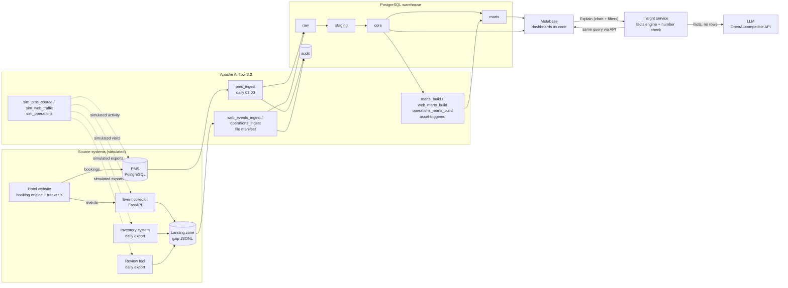

# HotelPulse

An end-to-end data platform for two simulated hotels: a 240-room city hotel in Lisbon and a
200-room resort in the Algarve. Apache Airflow loads four sources into a PostgreSQL
warehouse: PMS reservations, website tracking events, daily consumables exports and daily
review exports. Four Metabase dashboards show the results. 45 of the 49 dashboard charts (all
except tables) have an **Explain this chart** link. A deterministic facts engine computes what
the chart shows, a language model writes the explanation from those facts, and every number
in the text is checked against them.


Project site with the business memo: https://haoran-yang-henry.github.io/hotelpulse/

---

## Features

| Area | Implementation |
|---|---|
| Source simulation | The 119,390 bookings of the public *Hotel Booking Demand* dataset are replayed as a live PMS (PostgreSQL). Dates are shifted by whole years, rounded to whole weeks, so that the first `make up` day falls inside the data with 12–24 months of history and 2–14 months of future arrivals. Website visits, consumables and reviews are generated consistently with the PMS. Four anomalies are injected as ground truth ([table](#injected-anomalies)). |
| Warehouse | Schemas `raw → staging → core → marts`, plus `audit` and `insight`; 14 SQL migrations, applied once each and verified by checksum. |
| Orchestration | 11 Airflow DAGs. PMS extraction per data interval with a 2-day look-back; downstream DAGs are triggered by Airflow assets; backfills are idempotent (covered by an end-to-end test). |
| Data quality | 34 SQL checks (19 `error`, 15 `warn`) in 8 suites. Each check returns the violating rows; results go to `audit.dq_results`; a failing `error` check fails its task. |
| Observability | Failure callback after the last retry (2 retries, 2 minutes apart). A watchdog DAG runs every 15 minutes: freshness SLAs for 6 datasets, landing files not loaded after 2 hours, new data-quality warnings. Alerts are deduplicated for 6 hours and optionally posted to a Slack-compatible webhook. A *Data Platform Health* dashboard has 17 charts. |
| Website tracking | Demo booking website with a consent-first tracker: nothing is sent and no cookie is set before consent. The collector validates events against tracking contract v1 and writes gzip JSONL landing files partitioned by hour, with a dead-letter dataset for invalid events. Files are loaded exactly once via a manifest. Device clocks are corrected, bots and duplicates removed, sessions split after 30 minutes of inactivity. |
| Analytics | **Revenue:** occupancy, ADR, RevPAR, channel mix, commission cost, booking pace for the next 120 nights vs. same time last year. **Website:** closed booking funnel, payment errors, first- vs. last-touch attribution (30-day window), tracking coverage measured against the PMS. **Operations:** usage per occupied room night, cost per occupied room, 14-day purchase suggestion, reviews linked to the PMS stay. |
| Explain this chart | Facts engine: changes, trends, anomaly episodes in units of the series' own week-to-week noise, level shifts, divergence between series, share shifts, gaps to targets and last year. Narrative: headline, observations with fact references, possible causes with confidence, recommended actions. Number check: one retry with feedback, then unverified numbers are flagged. Without an LLM key, explanations consist of the facts only. |
| Dashboards as code | 4 dashboards (49 charts) defined as YAML + SQL in `bi/metabase/` and provisioned through the Metabase API. |
| Privacy | Guest e-mail addresses become salted SHA-256 keys in `staging`; names are dropped. The BI role `bi_reader` can read `core`, `marts`, `audit` and `insight` only. |

## Injected anomalies

Ground truth for the dashboards and for the evaluation of the explanations
(`src/hotelpulse/simulator/anomalies.yaml`). Days are relative to the anchor date (the first
`make up` day, or `SIM_ANCHOR_DATE`).

| ID | Anomaly | Active | Effect in the simulation |
|---|---|---|---|
| A1 | Mobile payment outage | days −24 to −11 | Each website booking made in the window moves to Booking.com with probability 0.55; the guest's failed mobile payments return `gateway_timeout`. |
| A5 | Consent-banner redesign | from day −60 | Analytics consent rate drops from 80 % to 55 %. |
| A2 | Laundry-supplier change (resort) | from day −35 | Towels laundered per occupied room night × 1.35. |
| A3 | Breakfast capacity | always | Breakfast complaints in reviews × 2.2 when the hotel's average occupancy during the stay is above 90 %. |

## Dashboards

Screenshots from a deployment with anchor date 2026-10-16.


*Revenue & Distribution (11 charts): occupancy, ADR, RevPAR and direct share; weekly trends
against last year; channel mix and commission; booking pace for the next 120 nights. The dip in
the website's share of new bookings from 22 Sep to 5 Oct 2026 is A1.*


*Website & Booking Funnel (11 charts): mobile payment success collapses and `gateway_timeout`
errors rise from 22 Sep 2026 (A1). Tracking coverage falls below the 60 % threshold after
17 Aug 2026 (A5). Attribution compares bookings credited to the first and to the last visit.*


*Operations & Guest Experience (10 charts): the resort's towels laundered per room night rose
from 1.79 to 2.36 after 11 Sep 2026 (A2); the purchase suggestion shows +25 % against the
previous 28 days. Over the last 26 weeks, 9.0 % of reviews from stays at 90 %+ occupancy
complain about breakfast, against 2.0–4.4 % at lower occupancy (A3).*


*Data Platform Health (17 charts): freshness of each dataset against its SLA, runs per DAG and
outcome (the 2 failed runs are the `ops_alert_drill` fire drill), average run duration, rows
loaded and data-quality results per day.*

### Explain this chart


*Explanation of "Payment success rate by device", previous 12 weeks: the facts engine flags the
drop on mobile only; the model writes the headline, observations with fact references,
possible causes and next steps; the badge confirms that every number matches a fact; the facts
are listed underneath.*

`make evaluate` scores the explanations against the injected anomalies
([report](docs/insight-evaluation.md); model `deepseek-v4-pro`, anchor date 2026-10-16):

| Metric | Result |
|---|---|
| Anomaly charts where the facts flag the affected series and its window or category | 6 / 6 |
| Anomaly charts where the narrative names them | 6 / 6 |
| Explanations with all numbers verified | 8 / 8 |
| False alarms on the 2 control charts | 0 / 2 |

### Findings

The [business memo](docs/business-memo.md) quantifies the anomalies from the warehouse data:

| Finding | Figure |
|---|---|
| A1: extra commission while direct bookers used Booking.com | €3.6k in 14 days (dashboard estimate; €3.3k by the simulation's ground truth) |
| A5: website bookings seen by the tracker | 72 % before 17 Aug 2026, 52 % after |
| A2: resort towels laundered per room night | 1.79 → 2.36 (+32 %), €25k a year |
| A3: reviews complaining about breakfast, last 12 months | 9.2 % at 90 %+ occupancy, 3.2–3.4 % below |

## Architecture



Docker Compose runs 8 services: PostgreSQL 17.11 (databases `pms`, `dwh`, `airflow`,
`metabase`; one least-privilege role per component), Airflow 3.3.2 (API server, scheduler,
DAG processor; LocalExecutor), Metabase 0.64.2.5, and three FastAPI services (demo hotel
website, event collector, insight service). Three one-shot containers apply migrations and
seed the sources (`bootstrap`), initialise Airflow (`airflow-init`) and provision the
dashboards (`metabase-provision`).

## Data pipeline workflow

**PMS reservations**

1. **Simulate**: `sim_pms_source` (hourly) writes every booking, check-in, check-out,
   cancellation and no-show whose time has passed into the PMS.
2. **Extract**: `pms_ingest` (daily, 03:00 Europe/Lisbon) reads rows with `updated_at` in the
   data interval plus a 2-day look-back, using the read-only role `pms_reader`. It appends them
   to `raw` with `_batch_id` and `_extracted_at`. If the warehouse is empty, it runs a full load.
3. **Stage**: the newest version of each guest and reservation is merged into `staging`
   (`MERGE`); codes are cleaned, data issues are flagged in `dq_issues`, e-mail addresses are
   hashed.
4. **Model**: `core` dimensions are upserted; `fct_reservation` and `fct_room_night` are
   rebuilt for the reservations changed in the batch.
5. **Serve**: `pms_ingest` updates the asset `core.fct_room_night`, which triggers
   `marts_build`. Each mart is rebuilt (`DELETE` + `INSERT`) in one transaction.
6. **Verify**: data-quality suites run after staging, core and marts.

**Website events**

1. **Collect**: the tracker posts event batches to the collector. The collector validates each
   event against the [tracking plan](docs/tracking-plan.md), adds the server timestamp and
   writes hourly-partitioned landing files. Invalid events go to `web_events_rejected`.
2. **Load**: `web_events_ingest` (hourly, minute 5) loads every file missing from
   `audit.loaded_files`. Each file and its manifest entry are written in one transaction.
3. **Stage**: duplicates are dropped by `event_id` (first delivery wins). Device clocks are
   corrected (`collector_ts - (sent_at - event_ts)`). Devices and bots are classified and UTM
   parameters parsed.
4. **Sessionise**: all sessions of each visitor in the batch are rebuilt (30-minute inactivity
   rule). `web_marts_build` then joins sessions with PMS reservations for attribution and
   tracking coverage.

**Consumables and reviews**

1. **Export**: `sim_operations` (daily, 02:30 Europe/Lisbon) writes the previous day's
   consumables usage per hotel and item, and the reviews posted that day: rating, text,
   per-topic sentiment and the guest's confirmation code. Both go to the landing zone.
2. **Load and stage**: `operations_ingest` (daily, 04:00 Europe/Lisbon) uses the same file
   loader. A re-exported day or an edited review replaces the earlier version (latest file
   wins).
3. **Serve**: `operations_marts_build` runs when exports are staged or the revenue marts
   change.
   - Usage is related to rooms sold and breakfast guests from the PMS.
   - Reviews are linked to their stay by confirmation code, with the hotel's average occupancy
     during the stay.
   - The purchase suggestion is the median usage per room night (breakfast covers: per
     breakfast guest) of the last 28 days × room nights on the books for the next 14 nights ×
     a safety factor (1.10; breakfast covers 1.05).

**Explaining a chart**

1. **Link**: a text card above each chart links to the insight service with the dashboard's
   current filter values. Metabase inserts them in display form (e.g. "Previous 12 weeks"),
   and the service converts them back to raw filter values.
2. **Query**: the insight service runs the chart's own query through the Metabase API, with a
   non-admin service account.
3. **Facts**: the engine computes the facts in the chart's number formats.
   - An anomaly is a deviation from the median of the neighbouring periods (±3), in units of
     the series' week-to-week noise (MAD of differences): ≥ 3.5 for a single point, ≥ 2 for
     each point of a run.
   - A level shift must fit the data better than a linear trend.
   - Target and last-year comparisons are computed in code.
4. **Narrative**: an OpenAI-compatible model writes the explanation. It receives the chart's
   title, description, intent, filters, the matching glossary entries and the facts; it never
   receives data rows.
5. **Verify**: every number in the answer must match a fact or a number from the chart's
   context, at the precision it is written with (%, pp, €, thousands separators, German and
   Chinese formats). A malformed or unverified answer gets one retry with feedback; after that,
   unverified numbers are flagged on the page.
6. **Cache and record**: answers are cached by chart, filters, data hash, model, prompt version,
   facts version and language. Requests and 👍/👎 feedback are stored in schema `insight`.

| DAG | Schedule (Europe/Lisbon) | Purpose |
|---|---|---|
| `sim_pms_source` | hourly | Write the simulated PMS events up to now |
| `pms_ingest` | daily 03:00 | PMS → raw → staging → core, with quality checks |
| `marts_build` | asset `core.fct_room_night` | `hotel_daily_kpi`, `channel_daily`, `channel_bookings_daily`, `booking_pace` |
| `sim_web_traffic` | every 15 minutes | Send simulated visits, consistent with the PMS, to the collector |
| `web_events_ingest` | hourly at minute 5 | Landing files → raw → staging → sessions, with quality checks |
| `web_marts_build` | asset `core.fct_web_session` or `core.fct_room_night` | Funnel, payment errors, attribution, tracking coverage |
| `sim_operations` | daily 02:30 | Write the previous day's consumables and review exports |
| `operations_ingest` | daily 04:00 | Export files → raw → staging, with quality checks |
| `operations_marts_build` | asset `staging.inventory_usage` or `marts.hotel_daily_kpi` | Consumables, reviews linked to stays, purchase suggestion |
| `platform_health` | every 15 minutes | Mirror DAG runs, check freshness SLAs, landing backlog and data-quality warnings, raise alerts |
| `ops_alert_drill` | manual | Fails on purpose to test the alerting path |

**Alerting**: a task that fails after its last retry raises an `error` alert from its failure
callback. The watchdog adds alerts for stale datasets, landing files not loaded after 2 hours,
and new data-quality warnings. Alerts are stored in `audit.alerts` (one per key within 6 hours)
and shown on the *Data Platform Health* dashboard. If `ALERT_WEBHOOK_URL` is set, they are also
posted to that Slack-compatible webhook.

## Data model

| Schema | Tables | Load strategy |
|---|---|---|
| `raw` | `pms_hotels`, `pms_room_types`, `pms_guests`, `pms_reservations` (source rows + `_batch_id`, `_extracted_at`); `web_events`, `web_events_rejected`, `inventory_usage`, `reviews` (JSON payload + `_file`, `_line`, `_batch_id`) | append-only; a re-run replaces its own batch or file |
| `staging` | `pms_hotels`, `pms_room_types`, `pms_guests`, `pms_reservations`, `web_events`, `inventory_usage`, `reviews` | PMS: newest version per key (`MERGE` / upsert); web events: first delivery wins; exports: latest file wins |
| `core` | `dim_date`, `dim_hotel`, `dim_room_type`, `dim_channel`, `dim_consumable`, `fct_reservation`, `fct_room_night`, `fct_web_event`, `fct_web_session` | `dim_date`, `dim_channel`, `dim_consumable` seeded by migrations; other dimensions upserted; facts rebuilt per changed reservation or visitor |
| `marts` | `hotel_daily_kpi`, `channel_daily`, `channel_bookings_daily`, `booking_pace`, `web_funnel_daily`, `web_payment_errors_daily`, `web_attribution`, `tracking_coverage_daily`, `consumables_daily`, `guest_reviews`, `review_topics`, `purchase_suggestion` | full rebuild, one transaction per mart |
| `audit` | `schema_migrations`, `load_log`, `loaded_files`, `dq_results`, `alerts`, `dag_runs`, `freshness` | append-only (`dag_runs` upserted) |
| `insight` | `explanations`, `requests`, `feedback` | written by the insight service |

KPI definitions:

- **Occupancy** = rooms sold / rooms available.
- **ADR** = room revenue / rooms sold.
- **RevPAR** = room revenue / rooms available.
- **STLY** = rooms on the books at the same time last year (364 days earlier, same weekday).
- **CPOR** = consumables cost / occupied rooms.

## Getting started

**Prerequisites:** Docker with Compose v2, GNU Make, and [uv](https://docs.astral.sh/uv/) for
local development. Tested with Docker Desktop on WSL2 with 8 GB of memory.

```bash
make env   # create .env from .env.example with generated secrets (existing lines are kept)
make up    # build and start; the first start downloads the dataset, seeds the PMS, writes
           # the website and operations history and provisions the dashboards
```

**AI-written explanations.** Set `LLM_API_KEY` in `.env` and run `make up` again. Without a
key, explanations contain the computed facts only. The evaluation above used:

```bash
LLM_BASE_URL=https://opencode.ai/zen/go/v1
LLM_MODEL=deepseek-v4-pro
LLM_REASONING_EFFORT=none
LLM_SESSION_HEADER=x-opencode-session
```

Any OpenAI-compatible Chat Completions endpoint works, for example OpenAI, DeepSeek, Ollama
or vLLM.

| Service | URL | Credentials |
|---|---|---|
| Metabase | http://localhost:3001 | `MB_ADMIN_EMAIL` / `MB_ADMIN_PASSWORD` from `.env` |
| Airflow | http://localhost:8081 | none (every user is admin; local use only) |
| Demo hotel website | http://localhost:8030 | - |
| Event collector | http://localhost:8010 | - |
| Insight service | http://localhost:8020 | opened from the dashboards |
| PostgreSQL | `localhost:5433` | roles and passwords in `.env` |

**Try the whole path:**

1. Book a room on the demo website and accept analytics cookies. Card number
   `4000 0000 0000 0002` is declined; any other number is accepted.
2. Run:

   ```bash
   make trigger DAG=pms_ingest          # load the reservation from the PMS
   make trigger DAG=web_events_ingest   # load the visit; web marts rebuild automatically
   ```

3. Find the booking, with its traffic source and the declined payment, in the
   *Website & Booking Funnel* dashboard.

```bash
make help        # list all targets
make ps          # service status
make logs        # follow logs (SERVICE=name to filter)
make psql        # psql on the warehouse as the pipeline role
make dashboards  # re-provision the Metabase dashboards
make down        # stop the stack, keep data
make clean       # stop and delete all data (volumes and landing zone; the dataset cache stays)
```

## Project structure

```
.
├── dags/                    # Airflow DAGs (orchestration only) and shared assets/helpers
├── src/hotelpulse/          # Python package
│   ├── simulator/           #   PMS, website-traffic and operations simulators, anomalies.yaml
│   ├── tracking/            #   event contract, collector service, tracker.js
│   ├── website/             #   demo hotel website and booking engine
│   ├── insight/             #   "Explain this chart": facts engine, narrative, number check
│   ├── pipelines/           #   PMS extraction and landing-file loading
│   ├── metabase/            #   Metabase API client and dashboard provisioning
│   ├── bootstrap.py         #   migrations and source seeding (bootstrap container)
│   ├── landing.py           #   landing-zone files (single place to switch to object storage)
│   ├── migrate.py           #   checksum-verified warehouse migrations
│   ├── observability.py     #   alerts, freshness SLAs, DAG-run mirror
│   └── quality.py           #   data-quality runner
├── warehouse/
│   ├── migrations/          # V001-V014 schema migrations
│   ├── sql/                 # transformations per layer (staging, core, marts)
│   └── tests/               # data-quality checks: <domain>/<layer>/*.sql
├── bi/metabase/             # dashboards (YAML), chart queries (SQL), KPI glossary
├── docs/                    # business memo, demo script, tracking plan, evaluation, site
├── infra/                   # Airflow image (Dockerfile), PostgreSQL init script
├── scripts/                 # .env generation
├── tests/                   # unit/, dags/, e2e/
├── .github/workflows/       # CI
├── Makefile
└── docker-compose.yml
```

## Development workflow

- **Branching:** `main` is always runnable; changes are made on `feature/*`, `fix/*` or
  `docs/*` branches and merged with `--no-ff`.
- **Commits:** [Conventional Commits](https://www.conventionalcommits.org/).
- **Pre-commit hooks:** trailing whitespace, end of file, YAML syntax, large files, private
  keys, ruff lint, ruff format, sqlfluff.
- **CI** (GitHub Actions, on pushes to `main` and on pull requests): ruff, sqlfluff and unit
  tests; DAG integrity tests inside the Airflow image.

| Command | What it runs |
|---|---|
| `make setup` | `uv sync` and pre-commit hook installation |
| `make lint` | ruff (lint, format check) and sqlfluff |
| `make test` | 138 unit tests: dataset, PMS extraction, facts engine, filter parsing, narrative and number check, insight service, migrations, observability, data-quality runner, simulators, tracking |
| `make test-dags` | 14 DAG integrity tests inside the Airflow image: no import errors, all DAGs present, tags, docs, no catchup, one active run, owner, failure callback, retries, `pms_ingest` ends with its quality gate |
| `make e2e` | 10 end-to-end tests against the running stack. They check service health; the warehouse is loaded and passes its `error` checks; every dashboard chart runs; a website booking and a tracking event reach the warehouse; reviews are linked to PMS stays; an explanation's numbers are verified; a failed task raises an alert; the watchdog records runs and freshness; a 3-day backfill changes nothing |
| `make e2e-clean` | `make clean`, `make up`, wait for the first pipeline runs, then `make e2e` |
| `make evaluate` | explanations of 6 anomaly charts and 2 control charts, scored against the injected anomalies; writes `docs/insight-evaluation.md` |

## Data sources and licences

- Code: [MIT licence](LICENSE).
- Booking data: Antonio, N., de Almeida, A., & Nunes, L. (2019). *Hotel booking demand
  datasets.* Data in Brief, 22, 41–49 (CC BY 4.0), downloaded from the TidyTuesday mirror and
  verified by SHA-256. Dates are shifted; hotel names are fictional.
- Guest names and e-mail addresses are synthetic (`@example.com`).
