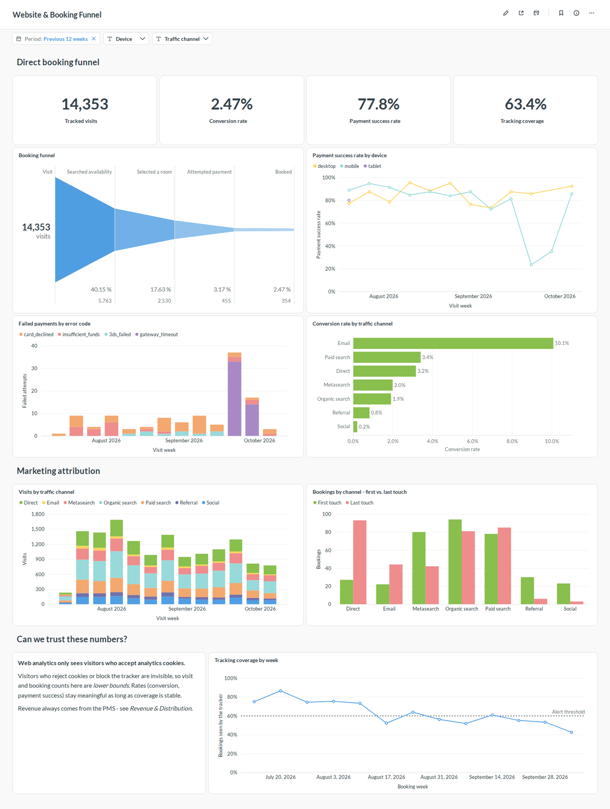
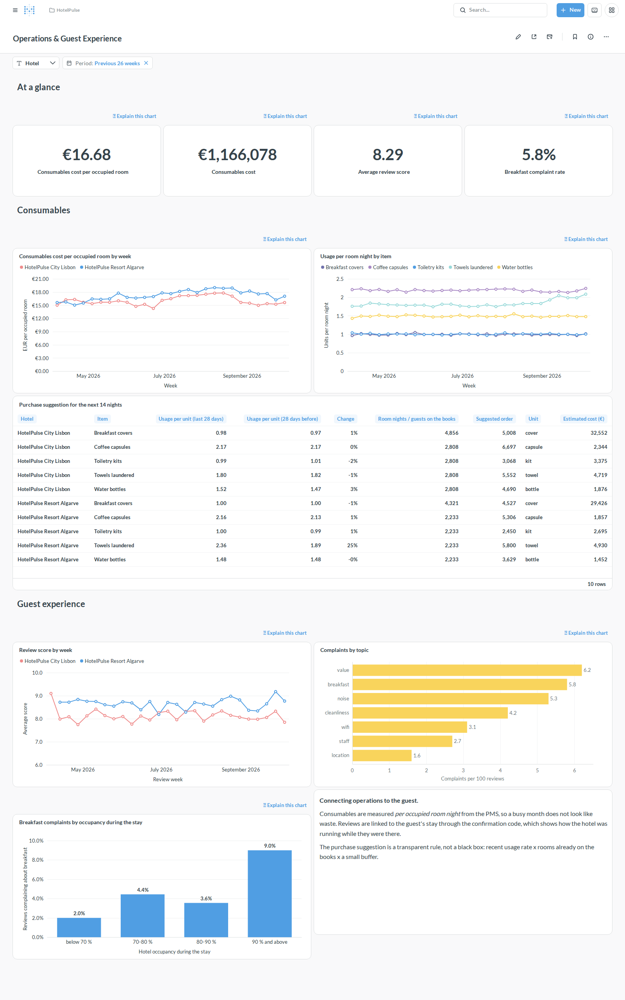
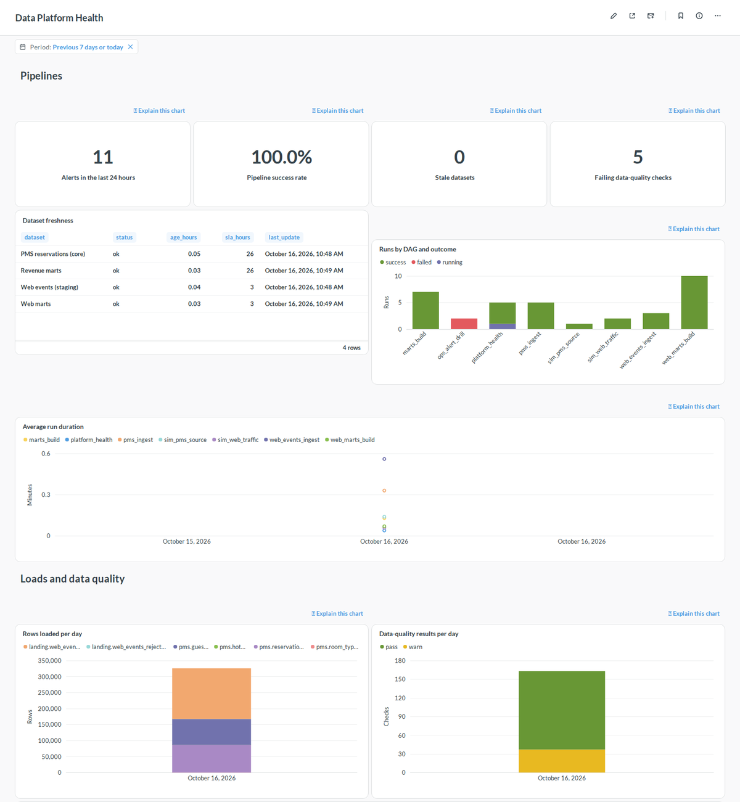
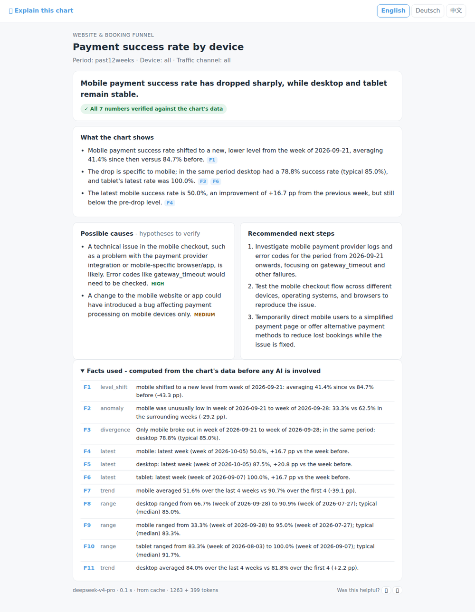
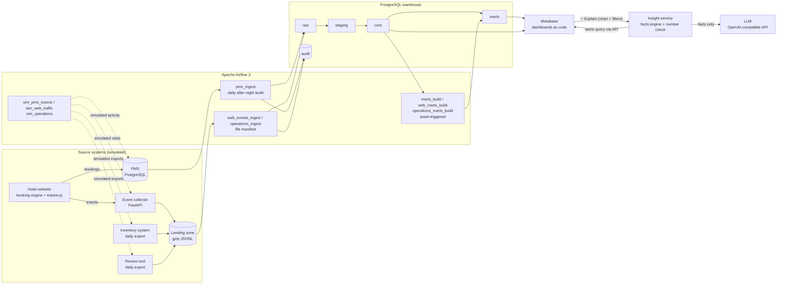

# HotelPulse

**An end-to-end data platform for hotel operations.** Bookings from the property management
system (PMS), website tracking events, consumables inventory and guest reviews flow through an
Airflow-orchestrated PostgreSQL warehouse into Metabase dashboards — and every chart gets a
button that explains what it shows in plain language.


---

## The business problem

A mid-sized hotel group (two properties: a city hotel in Lisbon and a resort in the Algarve)
reviews its operations every Monday. Three decisions keep coming back:

| Decision | Question the data must answer |
|---|---|
| **Revenue & distribution** | Only ~12 % of room nights are booked direct, OTAs charge 15–20 % commission. Where do direct bookers drop off, and what does it cost? |
| **Procurement & operations** | How many amenities will we need in the next two weeks? Which consumption figures are abnormal? |
| **Guest experience** | Why do ratings move? Do complaints correlate with operational pressure such as full-house days? |

The data sits in separate systems and the general managers have no time to read dozens of
charts. HotelPulse integrates the sources, models them into decision-oriented dashboards and
lets every chart **explain itself** in plain language.

## Features

| Area | What it does | Status |
|---|---|---|
| Living source systems | A simulated PMS replays 119k real bookings, shifted by whole years (seasons and weekdays stay aligned) so that history, today and future reservations line up with the wall clock. Known anomalies are injected as ground truth. | ✅ |
| Layered warehouse | `raw → staging → core → marts` in plain PostgreSQL SQL: append-only raw change log, `MERGE`-based staging, star schema, dashboard-ready marts | ✅ |
| Orchestration | Airflow 3 DAGs with incremental, idempotent loads (data-interval windows with look-back), asset-driven downstream scheduling, backfill support | ✅ |
| Data quality as code | SQL checks that return violating rows; results persisted to `audit.dq_results`; error-level failures stop the pipeline | ✅ |
| Observability & alerting | Data Platform Health dashboard (freshness SLAs, DAG success rates and durations, loads, data-quality trends, alerts, explain-feature usage); a failure callback alerts immediately, a watchdog DAG checks freshness, stuck landing files and data-quality warnings; optional Slack-compatible webhook | ✅ |
| Revenue analytics | Occupancy, ADR, RevPAR, channel mix and commission cost, booking pace (on-the-books vs. same time last year) | ✅ |
| Dashboards as code | Metabase questions and dashboards defined in YAML + SQL and provisioned through the Metabase API | ✅ |
| Privacy by design | Personal data stops at staging (salted hashes); BI uses a read-only role limited to modelled schemas | ✅ |
| Website tracking | Demo booking site with a consent-first JavaScript tracker, an event collector that validates against a versioned contract and writes a gzip JSONL landing zone, exactly-once file ingestion, clock-skew correction, bot and duplicate filtering, per-visitor incremental sessionisation | ✅ |
| Web analytics | Closed booking funnel by device and channel, payment errors, first- vs. last-touch attribution, and tracking coverage reconciled against the PMS | ✅ |
| Operations & guest experience | Daily consumables and review exports through the same exactly-once file loader; usage per occupied room night and cost per occupied room, a transparent 14-day purchase suggestion from rooms on the books, and reviews linked to the PMS stay to show how occupancy during the stay drives complaints | ✅ |
| **Explain this chart** | A link above every chart opens an explanation of exactly what the chart shows under the current filters: a deterministic facts engine (changes, trends, anomaly episodes, level shifts, divergence between series, share shifts, gaps to last year and to targets), an LLM narrative with hypotheses and next steps, and an automatic check of every number against the facts. Works without an LLM, too (facts-only mode). | ✅ |

## Dashboards


*Revenue & Distribution: KPIs, year-over-year trends, channel mix, direct booking intake and the booking pace for the next four months. The dip in direct bookings at the end of September is an injected anomaly (a mobile payment outage pushing guests to OTAs).*



*Website & Booking Funnel: the same outage seen from the website - mobile payment success collapses and `gateway_timeout` errors spike. Tracking coverage fell below the alert threshold after a cookie-banner redesign (a second injected anomaly), and first- vs. last-touch attribution shows how last-click reporting undervalues metasearch.*



*Operations & Guest Experience: consumables per occupied room night, so busy weeks do not look like waste - the resort's towels laundered per room night jumped by a quarter after a laundry-supplier change (injected), which the purchase suggestion flags before the next order. Reviews are linked to the guest's stay: when the hotel was 90 % full or more, breakfast complaints are more than twice as frequent (injected capacity problem).*



*Data Platform Health: freshness against SLAs, pipeline success rates and durations, rows loaded, data-quality trends and alerts (here: two alerts from the fire drill and the data-quality warnings the source data really has).*

### ✨ Explain this chart



*One click on "Explain this chart" above the payment chart: the facts engine finds the drop and that it only affects mobile; the model turns that into a headline, hypotheses to verify and next steps. All numbers are checked against the chart's data, and the facts used are listed underneath.*

Evaluated against the injected anomalies (`make evaluate`, [report](docs/insight-evaluation.md)):
the facts engine and the narrative both identify the affected series - and its time window or
category - in **6 of 6** anomaly charts across the website, revenue and operations dashboards,
**all** narratives pass the number check, and the control charts raise **no** false alarms.

## Architecture



All services run with Docker Compose: PostgreSQL 17 (warehouse, source system and application
databases with least-privilege roles), Airflow 3.3 (LocalExecutor), Metabase 0.64, and three small
FastAPI services - the demo hotel website, the event collector and the insight service.

## Data pipeline workflow

1. **Source simulation** — `sim_pms_source` runs hourly and reveals every booking, check-in,
   check-out, cancellation and no-show that has "happened" up to now.
2. **Extract** — `pms_ingest` runs daily after the hotels' night audit (03:00 Europe/Lisbon). It
   pulls rows changed in the data interval (plus a look-back window for late commits) with a
   read-only account and appends them to `raw` with batch metadata. An empty warehouse triggers
   an automatic full load.
3. **Stage** — the newest version of each entity is `MERGE`d into `staging`: types and codes are
   cleaned, data issues are flagged, personal data is replaced by salted hashes.
4. **Model** — `core` dimensions are refreshed; facts are maintained incrementally for exactly
   the reservations that changed in the batch (`fct_reservation`, `fct_room_night`).
5. **Serve** — finishing `pms_ingest` updates the `core.fct_room_night` asset, which triggers
   `marts_build` to rebuild the marts in a single transaction.
6. **Verify** — data-quality checks run after every layer; results are stored in
   `audit.dq_results`.

**Website events** follow a second, file-based path:

1. **Collect** — the tracker posts batches to the collector, which validates each event against
   the [tracking plan](docs/tracking-plan.md), stamps the server time and writes immutable,
   hourly-partitioned landing files (invalid events go to a dead-letter dataset).
2. **Load** — `web_events_ingest` loads every file not yet in `audit.loaded_files`, one
   transaction per file together with its manifest entry: exactly once, late files included.
3. **Stage** — deduplicate by `event_id`, correct device clocks
   (`collector_ts - (sent_at - event_ts)`), classify devices and bots, parse UTM parameters.
4. **Sessionise** — all sessions of every visitor seen in the batch are rebuilt (30-minute
   inactivity rule), then the web marts join sessions with PMS reservations for attribution and
   tracking coverage.

**Operational exports** - consumables usage and guest reviews - arrive once a night as files:

1. **Export** — the inventory system writes usage per hotel, day and item; the review tool
   writes the day's reviews with rating, text and per-topic sentiment, plus the guest's
   confirmation code. Both land in the landing zone in the same format as tracking events.
2. **Load and stage** — `operations_ingest` (04:00) reuses the exactly-once file loader; a
   re-exported day or an edited review replaces the earlier version.
3. **Serve** — `operations_marts_build` runs on new exports *or* new revenue marts: usage is
   related to rooms sold and breakfast guests from the PMS, reviews are linked to their stay
   and the hotel's occupancy during it, and the purchase suggestion multiplies the last 28 days'
   median usage rate by the room nights on the books for the next 14 nights (plus a buffer).

**Explaining a chart** happens on demand:

1. **Link** — every chart has a text card above it whose link carries the dashboard's current
   filter values (Metabase fills them in display form, e.g. "Previous 12 weeks"; the service
   parses them back to raw filter values).
2. **Query** — the insight service runs the chart's own query through the Metabase API with a
   non-admin service account, so the explanation sees exactly what the viewer sees.
3. **Facts** — a deterministic engine computes the facts, in the chart's own number formats.
   Anomalies are deviations from the local level measured in units of the series' week-to-week
   noise; level shifts must explain the data better than a trend; targets and last-year gaps
   are compared in code, never by the model.
4. **Narrative** — an OpenAI-compatible model (default: `deepseek-v4-pro`) writes headline,
   observations with fact references, hypotheses with confidence and next steps, using the chart's
   intent and a KPI glossary as context. Only aggregated chart data is sent.
5. **Verify** — every number in the answer must match a fact at the precision it is written
   with (%, pp, €, thousands, German and Chinese formats); otherwise the model gets one retry
   with feedback, after which unverified numbers are flagged on the page.
6. **Cache and learn** — answers are cached per chart, filters, data version, model and
   language; requests and 👍/👎 feedback are stored in schema `insight`.

| DAG | Schedule | Purpose |
|---|---|---|
| `sim_pms_source` | hourly | Advance the simulated PMS to the current time |
| `pms_ingest` | daily, 03:00 Europe/Lisbon | Extract → raw → staging → core, with quality checks |
| `marts_build` | on asset `core.fct_room_night` | Rebuild KPI, channel and booking-pace marts |
| `sim_web_traffic` | every 15 minutes | Send simulated visits, consistent with the PMS, to the collector |
| `web_events_ingest` | hourly | Landing files → raw → staging → sessions, with quality checks |
| `web_marts_build` | on `core.fct_web_session` or `core.fct_room_night` | Funnel, payment errors, attribution, tracking coverage |
| `sim_operations` | daily, 02:30 | Write yesterday's consumables and review exports, consistent with the PMS |
| `operations_ingest` | daily, 04:00 | Export files → raw → staging, with quality checks |
| `operations_marts_build` | on staged exports or revenue marts | Consumables per room night, reviews linked to stays, purchase suggestion |
| `platform_health` | every 15 minutes | Watchdog: mirror DAG runs, check dataset freshness SLAs, stuck landing files and data-quality warnings, raise alerts |
| `ops_alert_drill` | manual | Fails on purpose to test the alerting path end to end |

**When something goes wrong**, every task that fails after its last retry raises an error
alert immediately (failure callback); the watchdog adds alerts for stale datasets, landing files
that are not being loaded and new data-quality warnings. Alerts land in `audit.alerts` (deduplicated
for six hours), on the *Data Platform Health* dashboard and - if `ALERT_WEBHOOK_URL` is set - in a
Slack-compatible channel.

## Data model

| Layer | Content | Load strategy |
|---|---|---|
| `raw` | Source rows as extracted, plus `_batch_id` and `_extracted_at`; tracking events, consumables and reviews as JSONB with their landing file | append-only (change log), idempotent per batch / file |
| `staging` | One current row per entity, cleaned and typed, `dq_issues` flags, no PII; unique web events with corrected timestamps; consumables per day and item, reviews | `MERGE` on natural key; first delivery wins |
| `core` | `dim_date`, `dim_hotel`, `dim_room_type`, `dim_channel`, `dim_consumable`, `fct_reservation`, `fct_room_night`, `fct_web_event`, `fct_web_session` | dimensions upserted; facts incremental per changed reservation / visitor |
| `marts` | `hotel_daily_kpi`, `channel_daily`, `channel_bookings_daily`, `booking_pace`, `web_funnel_daily`, `web_payment_errors_daily`, `web_attribution`, `tracking_coverage_daily`, `consumables_daily`, `guest_reviews`, `review_topics`, `purchase_suggestion` | full rebuild in one transaction |
| `audit` | schema migrations, load log, loaded-file manifest, data-quality results, alerts, DAG run history, freshness checks | append-only |
| `insight` | explanation cache, requests, feedback | written by the insight service only |

KPI definitions follow hotel industry conventions: **Occupancy** = rooms sold / rooms
available, **ADR** = room revenue / rooms sold, **RevPAR** = room revenue / rooms available,
**STLY** = on-the-books "same time last year" (364 days back, weekday-aligned), **CPOR** =
consumables cost per occupied room.

## Getting started

**Prerequisites:** Docker with Compose v2 (about 5 GB of memory available to Docker), GNU Make,
and [uv](https://docs.astral.sh/uv/) for local development.

```bash
make env   # create .env with freshly generated secrets
make up    # build and start everything; first start seeds data and provisions dashboards
```

To get AI-written explanations, put an OpenAI-compatible endpoint into `.env` (OpenAI,
DeepSeek, OpenCode, or a local Ollama/vLLM server) and run `make up` again; without a key the
explanations are generated from the facts alone:

```bash
LLM_BASE_URL=https://opencode.ai/zen/v1
LLM_API_KEY=...
LLM_MODEL=deepseek-v4-pro
```

| Service | URL | Credentials |
|---|---|---|
| Metabase | http://localhost:3001 | `MB_ADMIN_EMAIL` / `MB_ADMIN_PASSWORD` from `.env` |
| Airflow | http://localhost:8081 | none (local demo mode) |
| Demo hotel website | http://localhost:8030 | - |
| Event collector | http://localhost:8010 | - |
| Insight service | http://localhost:8020 | opened from the dashboards |
| PostgreSQL | `localhost:5433` | roles and passwords in `.env` |

**Try the whole path yourself:** book a room on the demo website (accept analytics cookies;
card `4000 0000 0000 0002` is declined, any other number works), then

```bash
make trigger DAG=pms_ingest          # load the new reservation from the PMS
make trigger DAG=web_events_ingest   # load your visit; web marts rebuild automatically
```

and find your booking - with its traffic source and the declined payment - in the
*Website & Booking Funnel* dashboard.

Useful commands:

```bash
make help        # list all targets
make ps          # service status
make psql        # psql session on the warehouse
make e2e         # end-to-end tests against the running stack
make evaluate    # score the explanations against the injected anomalies
make down        # stop (data is kept)
make clean       # stop and delete all data volumes
```

## Project structure

```
.
├── dags/                    # Airflow DAGs (orchestration only)
├── src/hotelpulse/          # Python package
│   ├── simulator/           #   PMS, website-traffic and operations simulators, anomalies
│   ├── tracking/            #   event contract, collector service, tracker.js
│   ├── website/             #   demo hotel website and booking engine
│   ├── insight/             #   "Explain this chart": facts engine, narrative, number check
│   ├── pipelines/           #   extraction and file-loading helpers used by DAGs
│   ├── metabase/            #   API client and dashboards-as-code provisioning
│   ├── landing.py           #   landing-zone files (swap point for object storage)
│   ├── migrate.py           #   checksum-verified warehouse migrations
│   └── quality.py           #   data-quality runner
├── warehouse/
│   ├── migrations/          # V###__*.sql schema migrations
│   ├── sql/                 # transformations per layer (staging, core, marts)
│   └── tests/               # data-quality checks per domain and layer
├── bi/metabase/             # dashboards (YAML + SQL), chart intents, KPI glossary
├── docs/                    # tracking plan (generated), explanation evaluation, images
├── infra/                   # Dockerfile and database initialisation
├── tests/                   # unit tests and DAG integrity tests
└── docker-compose.yml
```

## Development workflow

- **Branching:** trunk-based. `main` is always runnable; work happens on short-lived
  `feature/*` branches merged with `--no-ff`.
- **Commits:** [Conventional Commits](https://www.conventionalcommits.org/) (`feat:`, `fix:`,
  `docs:`, `test:`, `refactor:`, `ci:`, `chore:`).
- **Quality gates:** pre-commit hooks (ruff lint + format, sqlfluff, YAML checks, private-key
  detection) locally; the same checks plus tests run in GitHub Actions on every push.

| Command | What it runs |
|---|---|
| `make setup` | `uv sync` and pre-commit hook installation |
| `make lint` | ruff and sqlfluff |
| `make test` | unit tests (simulators, tracking, facts engine, number check, provisioning, ...) |
| `make test-dags` | DAG integrity tests inside the Airflow image |
| `make e2e` | end-to-end tests against the running stack: health, all dashboard cards, website booking and tracking events through to the warehouse, explanations, alerting, an idempotent backfill |
| `make e2e-clean` | the same from scratch: wipe, rebuild, wait for the first pipeline runs, test |
| `make evaluate` | detection rate of the explanations on the injected anomalies (needs the stack) |

## Data sources and licence notes

- Booking data: Antonio, N., de Almeida, A., & Nunes, L. (2019). *Hotel booking demand
  datasets.* Data in Brief, 22, 41–49 (CC BY 4.0), mirrored by TidyTuesday. Dates are shifted;
  hotel names are fictional.
- Guest names and e-mail addresses are synthetic (`@example.com`).
